<div align="center">

# OpenSign · CoolLED

**Drive CoolLEDX / CoolLEDM Bluetooth LED signs from your computer — no vendor app, no guessed protocol.**

[](https://www.python.org/)
[](#status)
[](LICENSE)
[](#verified-on-hardware)

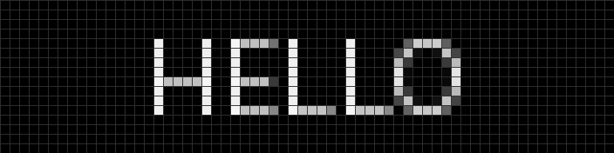

</div>

`opensign-coolled` is a Python toolkit and localhost HTTP API for the cheap "CoolLEDX" / "CoolLEDM" Bluetooth LED matrix signs normally driven only by a closed mobile app. It scans for a panel, reads its geometry and GATT layout, then compiles and sends frames directly.

The design rule is **evidence before claims**: there are no hardcoded UUIDs, command bytes, or keys. Everything the codec does is backed by a device-profile field carrying a status (`unverified` → `experimental` → `verified`) and a cited source, so the tool never pretends to know more about your hardware than it has proven.

## Gallery

Each row runs one source through the codec so you can compare it three ways: the **original artwork**, OpenSign's **64×16 render**, and the **same frames on the panel**. The render column is produced by the same `coolled … --preview` path that drives the panel, so it's the *exact* 64×16, 7-colour, 1-bit-per-channel output the codec ships — just scaled 8× for legibility. The two **Gengar temporal** rows are the exception: their renders are the blend of many one-bit subframes (see [Temporal colour](#temporal-colour-shades-between-the-8)). A still of a 64×16 board looks busy up close; in motion it reads far better, which is what the panel recordings on the right show.

| Example | Source | OpenSign render →&nbsp;panel | On the panel |
| :---: | :---: | :---: | :---: |
| **Nyan cat**<br><sub>`nian.gif` · 12 frames<br>`--dither none`</sub> |  | 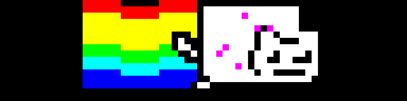 | 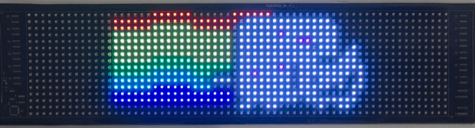 |
| **Sonic**<br><sub>`sonic-the-hedgehog.gif` · 4 frames<br>`--dither none`</sub> |  |  | 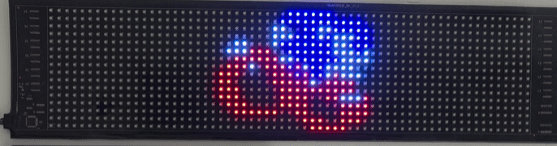 |
| **Matrix still**<br><sub>`matrix_still.png` · still<br>`--dither ordered`</sub> | 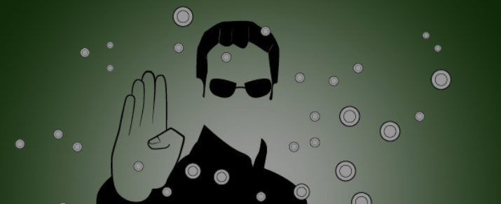 | 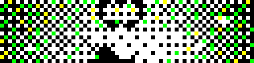 | 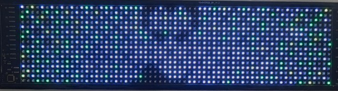 |
| **Gengar still**<br><sub>`gengar.jpg` · still<br>`--dither none`</sub> |  | 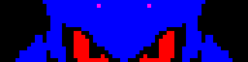 | 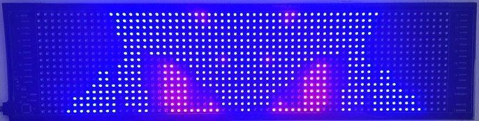 |
| **Gengar temporal 16**<br><sub>`gengar.jpg` · 16&nbsp;subframes, blended<br>`--temporal 16`</sub> |  |  | 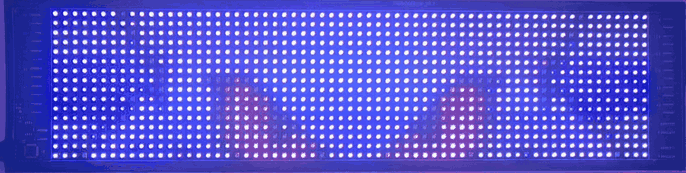 |
| **Gengar temporal 79**<br><sub>`gengar.jpg` · 79&nbsp;subframes, blended<br>`--temporal 79`</sub> |  |  | 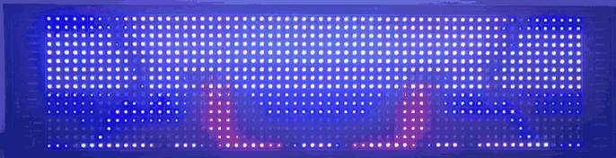 |

<details>
<summary>Reproduce the renders</summary>

```bash
coolled anim examples/downloaded/nian.gif \
  --fit contain --key-color auto --dither none \
  --preview examples/generated/gallery/nian.preview.gif

coolled anim examples/downloaded/sonic-the-hedgehog.gif \
  --fit contain --key-color auto --dither none \
  --preview examples/generated/gallery/sonic-the-hedgehog.preview.gif

coolled image examples/generated/matrix_still.png \
  --fit cover --dither ordered \
  --preview examples/generated/gallery/matrix-still.png

coolled image examples/downloaded/gengar.jpg \
  --fit cover --auto-levels --dither none \
  --preview examples/generated/gallery/gengar.none.png

# Temporal colour: one-bit subframes; a .png preview shows them blended
for n in 16 79; do
  coolled image examples/downloaded/gengar.jpg \
    --fit cover --auto-levels --temporal "$n" \
    --preview "examples/generated/gallery/gengar.temporal$n.png"
done

# Dither comparison (colorbar.source.png is a synthesized full-spectrum hue sweep)
for d in none ordered floyd; do
  coolled image examples/generated/gallery/colorbar.source.png \
    --fit fill --dither "$d" \
    --preview "examples/generated/gallery/colorbar.$d.png"
done
```

`--preview` renders locally and **skips BLE**; drop it (and add `--profile device_profile.local.json`) to play on hardware. Panel captures live in `examples/recordings/`.
</details>

### Drawn by an agent

An AI agent drew these through the [MCP server](#mcp-server). Each is a scene: small sprites written as text, placed by coordinate, checked by eye in `render`'s picture, then sent with `plan` and `accept`. The files in [`examples/scenes/`](examples/scenes) are the whole of each drawing.

| Scene | Render |
| :---: | :---: |
| **Night skyline**<br><sub>`night-skyline.json`<br>4 frames · 300 ms</sub> | 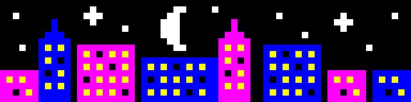 |
| **Pac-Man chomp**<br><sub>`pacman-chomp.json`<br>4 frames · 150 ms</sub> | 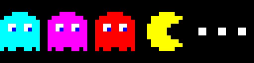 |

`uv run python scripts/render_scenes.py` rebuilds these renders and a frame bundle for each scene, and `coolled send examples/generated/scenes/night-skyline.bundle.json` plays one on the panel. To look at a drawing before sending it without the MCP server, `uv run python scripts/picture.py SOURCE OUT.png` renders a scene file or a text drawing to the same picture `render` returns. [`pacman-chomp.txt`](examples/scenes/pacman-chomp.txt) is the chomp as it was first drawn, by hand in `draw`'s format: 2,560 characters that compile to the same frames as its scene.

### Dithering: faking colours the panel doesn't have

The panel is 1 bit per channel — 8 states total (black, red, green, blue, cyan, magenta, yellow, white). A full-spectrum bar has far more colours than that, so the codec either snaps each pixel to the nearest of the 8 (`--dither none`) or trades spatial detail for apparent colour with ordered or Floyd–Steinberg dithering:

| Source hue sweep | `--dither none` | `--dither ordered` | `--dither floyd` |
| :---: | :---: | :---: | :---: |
| 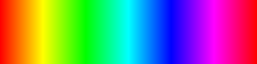 |  | 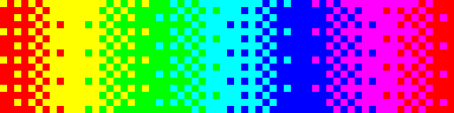 | 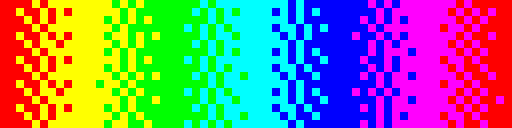 |

`none` shows the panel's real gamut as hard bands; `ordered` and `floyd` checkerboard adjacent colours so the eye blends them into the in-between hues. Rule of thumb: **pixel art and logos → `none`** (crisp, already near the gamut); **photos, gradients, and busy animation → `ordered`** (no frame-to-frame shimmer) **or `floyd`** (best detail on a single still).

### Temporal colour: shades between the 8

`--temporal N` turns a still into a loop of N one-bit subframes that the panel plays by itself, so a pixel's brightness comes from how many subframes light it: lit in 4 of 16 reads as a quarter-bright colour. The Gengar temporal renders show the subframes blended, the image your eye should see, and the recordings show how close the panel gets. Measured against the source fitted to 64×16:

| Gengar | Average difference from the source, per channel (0–255) | Loop repeats |
| --- | :---: | :---: |
| Plain still, `--dither none` | about 75 | — |
| `--temporal 16` | about 5 | 62.5 times a second |
| `--temporal 79` | about 1 | 12.7 times a second |

More subframes blend closer on paper, but the eye only blends a loop that repeats faster than about 62 times a second, and the panel can't hold a subframe for less than 1 ms. Past 16 subframes the loop slows down, so the darkest and brightest shades flicker, and the camera catches a different part of the loop in each frame, which is the shimmer in the 79-subframe recording. `coolled image` still sends such a loop, with a warning, in case you want to overdrive it on purpose.

## Architecture

Frames flow one way: rendering never touches Bluetooth, only the codec knows the wire format, and only the transport touches the radio, where the sign's per-chunk acks come back to pace each chunk. The `coolled` CLI, the localhost API, and the MCP server drive the same pipeline through `ProtocolRuntime`, which encodes and delivers on one BLE session (adding follow-ups such as the still's static mode); the MCP server only dry-runs that delivery until it is started with `--execute`.

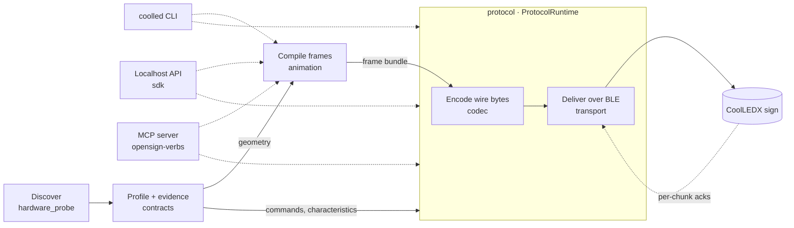

## Install

```bash
python -m venv .venv
source .venv/bin/activate            # Windows PowerShell: .venv\Scripts\Activate.ps1
python -m pip install -e '.[api,dev]'
```

Python 3.11+. Core dependencies are **Bleak** (BLE) and **Pillow** (rendering); **FastAPI** + **Uvicorn** are optional (`[api]` extra). Installs the umbrella `coolled` command plus `opensign-scan`, `opensign-preview`, `opensign-send`, `opensign-api`, and `opensign-verbs` (`[mcp]` extra).

## Quickstart

Render/send commands **write to the panel by default**, showing a live progress line and a short transfer summary. Add `--dry-run` to build the byte-exact transfer plan without touching Bluetooth, and `-v` to print the full plan/result JSON; supplying `--preview PATH` also always disables delivery.

```bash
# No hardware: render a preview to a file
coolled preview --pattern text --text 'OPEN SIGN' --width 64 --height 16 --scale 12 --output out.gif

# Find your sign (read-only). Power-cycle it first: some panels advertise their name only briefly after power-on.
coolled scan --names CoolLEDX CoolLEDM --timeout 10

# Inspect it and write a profile candidate (read-only GATT enumeration)
coolled inspect '<address-or-id>' --width 64 --height 16 \
  --output evidence/gatt/panel.json --profile-out device_profile.local.json

# Play something (coolled reads device_profile.local.json by default)
coolled text "HELLO WORLD"                       # firmware-native scroll where available
coolled image logo.png --auto-levels
coolled animation clip.webp                      # aliases: anim, gif
coolled animation clip.gif --scroll              # march the clip across the panel
coolled text "HELLO WORLD" --preview hello.gif        # writes the preview; does not send

# Controls
coolled control --profile device_profile.local.json --command brightness --value 50
coolled control --profile device_profile.local.json --command power --value true

# Localhost API (render-only until you arm it with --execute)
coolled serve --profile device_profile.local.json --execute
curl -X POST http://127.0.0.1:8124/text -H 'content-type: application/json' \
  -d '{"panel_id":"desk-sign","text":"HELLO","scroll":true}'
```

`coolled inspect` never promotes a characteristic automatically; `--select-singletons` is an operator decision made after reviewing the GATT evidence.

## Commands

| `coolled …` | Direct entry point | What it does |
| --- | --- | --- |
| `scan` | `opensign-scan scan` | Scan advertisements and rank CoolLED candidates (read-only) |
| `inspect <id>` | `opensign-scan inspect` | Enumerate one device's GATT and draft a profile candidate |
| `preview …` | `opensign-preview` | Render a pattern to a local `.gif`/`.png` (no hardware) |
| `text "MSG"` | — | Render text (scrolling by default) and send |
| `image <path>` | — | Fit an image to the panel and send; a still also sets the panel's movement mode to static, so it never inherits the scroll `text` left behind |
| `animation <path>` | `anim`, `gif` | Render an animated GIF, WebP, APNG, or other Pillow-supported image and send |
| `send <bundle>` | `opensign-send bundle` | Send a prepared frame-bundle JSON |
| `control …` | `opensign-send control` | Send a control command (`brightness`, `power`, …) |
| `serve` | `opensign-api` | Run the localhost API |

Flags worth knowing (run `coolled <command> --help` for the full list):

- **Every render/send command:** `--dry-run`, `-v`/`--verbose` (print the full plan/result JSON), `--preview PATH` (write a `.png`/`.gif` of exactly what the panel would light, instead of sending), `--bundle-out PATH`, `--rotate {0,90,180,270}`, `--flip-horizontal`/`--flip-vertical`, `--profile PATH`.
- **Fit (`image`, `animation`):** `--fit contain` keeps the whole source with padding, `cover` fills by cropping, and `fill` distorts the aspect ratio (`stretch` is an alias for `fill`).
- **Colour (`image`):** `--dither`, `--auto-levels`, `--black-level`, `--white-level`, and `--temporal N` for [temporal colour](#temporal-colour-shades-between-the-8). Above 16 subframes it warns but still sends; a `.png` preview shows the subframes blended, a `.gif` shows them raw.
- **Animation:** `--key-color` / `--key-tolerance` knock a bright background out to black; `--scroll` (with `--scroll-px` / `--direction`) marches the clip across the panel as a sprite.
- **Caching:** image and animation renders are cached by source contents, panel geometry, and options. `--no-cache` rebuilds and `--cache-dir PATH` moves the cache, which also remembers each panel's upload rate so the progress line's time-left is right from the first chunk.

### HTTP API

`coolled serve` binds `127.0.0.1:8124` and exposes:

| Method | Path | Purpose |
| --- | --- | --- |
| `GET` | `/status` | Per-panel state, scheduled jobs, optional diagnostics |
| `POST` | `/text` | Render + play text (device-native firmware scroll by default; `native=false` for the host flipbook, `scroll=false` for static) |
| `POST` | `/image` | Fit + play an image (static, or a temporal-colour FRC loop via `temporal`; a loop too slow to blend comes back with `warnings`) |
| `POST` | `/animation` | Compile + play a bounded base64 GIF/APNG (subsampled to the frame buffer); `scroll=true` marches it across the panel |
| `POST` | `/bundle` (alias `/scene`) | Play a pre-rendered frame-bundle JSON |
| `POST` | `/brightness` | Set brightness (0–100%) |
| `POST` | `/power` | Turn the panel on/off |

`/animation` and `/image` (`temporal`) compile server-side. The API's `/text` now uses the device-native firmware scroll by default (matching `coolled text`); pass `native=false` for the host-side flipbook or `scroll=false` for a single static frame.

### MCP server

`opensign-verbs` is an [MCP](https://modelcontextprotocol.io) server, `coolled-verbs`, that lets an agent see what the panel would show, draw on it, and send to it once you allow that. It follows the verbs-and-nouns shape of smdl-factory's `smdl-verbs`: call a verb with no noun to list its nouns.

| Verb | Nouns | Returns |
| --- | --- | --- |
| `describe` | `panel`, `legend`, `upload` | Geometry, colours, capability statuses, and whether `accept` sends; the character each colour renders as; the last upload's progress or result |
| `render` | `text`, `draw`, `scene`, `pattern`, `image`, `animation`, `bundle` | Each frame as a picture and as text, one character per pixel (`.` off, `#` lit, or a colour letter) |
| `plan` | the same as `render` | What the panel will show, the packets a send writes, blockers, warnings, and a `plan_id`; never sends |
| `accept` | none; takes a plan's `plan_id` | Sends the plan, but only on a server started with `--execute` |

`render` compiles through the same `PixelAnimationStudio` as the CLI, so the grid matches `--preview`: scrolling text and animations (in place or with `scroll`) are trimmed to the same frame budget the CLI sends (79 at 64×16), and `fit` takes the CLI's `contain`, `cover`, and `fill`. `render` and `plan` also return the frames as one picture, each LED drawn 8 pixels wide on a grid and the frames stacked top to bottom, so an agent that can see images can judge the result at a glance; `picture=false` leaves it out.

```
render text value=HELLO   (rows 4-11 of 16)
................#....#..####..#.....#......###..................
................#....#..#.....#.....#.....#...#.................
................#....#..#.....#.....#....#.....#................
................#....#..#.....#.....#....#.....#................
................######..####..#.....#....#.....#................
................#....#..#.....#.....#....#.....#................
................#....#..#.....#.....#.....#...#.................
................#....#..#####.#####.#####..###..................
```

`draw` goes the other way: it reads frames written in that legend, with `#` lighting the `foreground` colour, centres a drawing smaller than the panel, and starts a new frame after each blank line (`frame_ms` sets how long each one shows). Planning this red heart returns *Show the drawing on desk-sign as a still: 5 packets, about 1 s to upload*:

```
plan draw value=
.RR.RR.
RRRRRRR
RRRRRRR
.RRRRR.
..RRR..
...R...
```

`draw` suits a small picture. Composing a full panel that way means counting characters across 64-column rows, so `scene` lets an agent draw each sprite once and place copies by coordinate instead:

```json
{
  "sprites": {
    "ghost": ["...XXXX...", ".XXXXXXXX.", "XXXXXXXXXX", "XXWWXXWWXX", "XXWBXXWBXX",
              "XXXXXXXXXX", "XXXXXXXXXX", "XXXXXXXXXX", "XXXXXXXXXX", "X.XX..XX.X"]
  },
  "items": [
    {"sprite": "ghost", "at": [12, 3], "colors": {"X": "cyan"}},
    {"sprite": "ghost", "at": [24, 3], "colors": {"X": "red"}}
  ]
}
```

In a sprite `.` is transparent, legend letters light their colour, and any other letter, like `X` here, takes the colour each copy's `colors` gives it. `at` is the sprite's top-left corner and may hang off the panel; later placements draw on top. `items` appear in every frame, and an optional `frames` list adds each frame's own placements on top of them, so a four-frame Pac-Man chomp is five small sprites and a list of positions. It compiles to exactly the packets of the same animation hand-drawn as 2,560 characters of `draw`.

`plan` dry-runs the real delivery. Its `plan_id` is a hash of the exact packet bytes and the panel they go to, and its `next` field holds the matching `accept` call, which needs only that `plan_id`: the server remembers its last 32 plans (and forgets them on restart, after which `accept` also takes the plan's `arguments`). `accept` plans the same content again and refuses if the bytes have changed since (an edited source file, a re-profiled panel), so what goes out is what was reviewed. Scrolling text goes out as the panel's native firmware scroll, as with `coolled text`. An upload still running after 25 seconds carries on in the background, where `describe upload` follows it; a full 79-frame upload takes about a minute on the reference panel.

Install with `pip install -e '.[mcp]'` and register the server with your client. Give the command as an absolute path, because MCP clients start servers outside your virtualenv, and add `--execute` only if agents may send:

```json
{
  "mcpServers": {
    "coolled-verbs": {
      "command": "/path/to/coolled-sign-controller/.venv/bin/opensign-verbs",
      "args": ["--profile", "/path/to/device_profile.local.json", "--execute"]
    }
  }
}
```

## Verified on hardware

Reference panel: **CoolLEDX, 64×16, 7-colour, firmware 6** (BLE MAC `ff:00:00:06:6f:82`).

| Capability | Opcode | Status | Notes |
| --- | --- | :---: | --- |
| Brightness | `0x08` | **verified** | Brightness sweep visibly changed the panel (2026-07-13) |
| Static image | `0x03` | **verified** | 4-chunk image acked per-chunk and displayed (2026-07-13) |
| Stored animation | `0x04` | **verified** | Stored/looped a clip (2026-07-13); the payload limit is 30 KiB including the header, so 79 frames at 64×16 (80 is rejected, 2026-08-15) |
| Native text scroll | `0x02` | **verified** | Wide bitmap scrolled by firmware; `coolled text --speed 0..10` (2026-07-14) |
| Temporal colour (FRC) | via `0x04` | **observed** | Sub-frame loop reads as intermediate tones above the ~62 Hz fusion ceiling; recorded at 16 and 79 subframes in the gallery (2026-10-30) |
| Per-chunk ack pacing | notify | **verified** | `acks_received=4/4` on a 4-chunk frame |
| Power on/off | `0x09`/`0x13`/`0x12` | *experimental* | Reference-driver mapping; not yet isolated on this panel |
| Scroll mode | `0x06` | **verified** | `mode=left` scrolled the native banner (2026-07-14); `mode=static` after a still keeps it from inheriting that scroll (2026-10-30) |
| Scroll speed | `0x07` | **verified** | Higher byte = faster; CLI `--speed 0..10` maps linearly to 0..255 |

**Still open:** exercise the `0x06` checksum-error NAK re-send on real hardware (decoded and wired, but only `0x00` acks confirmed so far); device-side asset/hash cache discovery, multi-panel fan-out, and API auth/rate-limiting.

## Profiles & the evidence model

A `device_profile.*.json` is the single source of truth every module reads — geometry, characteristics, connection parameters, and a `protocol` section whose commands each carry a `status` and cited `evidence`.

- **`device_profile.json`** — the checked-in *starter*: empty, unverified, protocol-agnostic.
- **`device_profile.local.json`** — the profile you generate for *your* panel with `coolled inspect` (git-ignored).

Claims move `unverified → experimental → verified` and never skip a step (`verified` requires a live-hardware entry). Encoding is gated on this status — the runtime will encode an `experimental` claim, since a controlled live test is how evidence gets promoted, while the separate `--execute` / `--dry-run` flag decides a real BLE write vs. a plan. Full ledger and promotion checklist: [`protocol.md`](protocol.md).

## Safety

- The API listens on `127.0.0.1` with **no built-in authentication** — never expose it without an authenticated reverse proxy.
- CLIs write to the panel by default (`--dry-run` to preview); the API and the MCP server stay render-only until started with `--execute`, and the MCP server's `accept` sends only a plan whose bytes still match its `plan_id`.
- A command or schema must be at least `experimental` (with cited evidence) before the codec will encode it.
- Treat captures as sensitive: never commit private keys, pairing data, device identifiers, or unrelated personal traffic.

## Development

```bash
make test          # PYTHONPATH=src python -m pytest
ruff check .       # lint (config in pyproject.toml)
make install-api   # editable install with the API extra
```

Tests cover contracts, classification, rendering, frame-bundle round trips, chunking, scheduler behaviour, and render-only orchestration. Hardware tests are intentionally separate — they need a physical panel and reviewed evidence, gathered with the one-shot `scripts/live_*.py` harness.

## Repository map

```text
src/opensign/
  cli.py                 The umbrella `coolled` command
  contracts.py           Shared device / profile / frame-bundle contracts
  hardware_probe/        Discovery, GATT inspection, profile generation
  protocol/              Codec, packet framing, chunking, BLE transport, ProtocolRuntime
  animation/             Rendering, temporal colour, scenes, frame bundles, previews, render cache
  sdk/                   Registry, API, MCP server, scheduler, orchestration, trace state
schema/                  JSON Schemas for the stable contracts
scripts/                 Live hardware harness + one-shot experiments
evidence/                Captures and provenance
examples/                Source clips, agent-drawn scenes, generated previews (incl. the README gallery), panel recordings
specs/                   Internal design specs (SMDL) — not needed to run anything
protocol.md              Evidence ledger and promotion process
```

## Status

Alpha: the discover → render → encode → deliver path is verified end-to-end on the reference panel, but this is a research-grade tool for a reverse-engineered protocol, not a polished product. Released under the [MIT License](LICENSE); parts of the CoolLEDX codec are adapted from [coolledx-driver](https://github.com/UpDryTwist/coolledx-driver) (also MIT), see [THIRD_PARTY_NOTICES.md](THIRD_PARTY_NOTICES.md).
