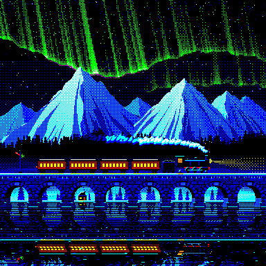
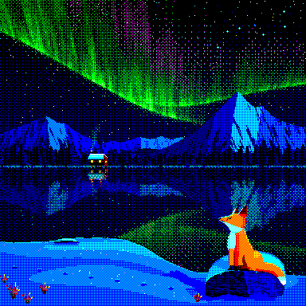

# Bake-off: pixel-art-studio and the scene workspace

Two fresh Claude Opus 5.5 agents got the same one-line brief, "Draw a scene of your choice", on a 384×384 still in the panel's eight colors ([`BRIEF.md`](BRIEF.md)). Each could read only the brief and its own tool:

- **A** used [pixel-art-studio](https://github.com/Gamezxz/pixel-art-studio) (MIT, commit `f8c2466`), an agent skill in which the agent writes a Pillow build script, previews it, critiques it against a checklist and repeats.
- **B** used the scene workspace in [`tools/scene-workspace/`](tools/scene-workspace): the ringed planet's `workspace.py` with a `render` command added, and a one-page [`HOWTO.md`](tools/scene-workspace/HOWTO.md) that says nothing about the planet.

Neither agent saw the other's work, the ringed planet, or the conversation that set this up. The two finals were shown to the author under random labels, and he preferred B on both questions asked: which is the better picture, and which looks more like deliberate pixel art up close. He called it close.

| A · pixel-art-studio | B · scene workspace |
| :---: | :---: |
|  |  |

| | A · pixel-art-studio | B · scene workspace |
| --- | --- | --- |
| Time | about 44 minutes | about 63 minutes |
| Looks | 32: 14 previews, 16 close crops, 2 at 1:1 | 38: 12 overviews, 23 region looks (13 of the fox), 3 at 1:1 |
| Tool calls | 148 | 241 |
| Workspace commands | | region 24, overview 13, trace 12, snap 32, diff 3, hidden 3, outline 2 |

## What the runs showed

- **Both agents chose nearly the same scene:** the northern lights over snowy peaks and a still lake, with reflections and a lit cabin. With the same model, brief and colors, the open brief mostly compared execution.
- **Both drew with their own code** and an ordered dither onto the eight colors. A used pixel-art-studio only for previews, stats and the 1:1 export, so the tools differed mainly in how the agent looked at its work and fixed it.
- **Both zoomed in often.** B also traced 12 pixels back to the sprite that painted them and diffed its versions 3 times. Whether that is why the fox reads well, one pair can't say.
- **B cost more:** about 45% longer and two-thirds more tool calls.

## What it didn't settle

- **More than one pair.** One piece each is a pilot, not a measurement.
- **Animation.** pixel-art-studio ships idle loops, walk cycles and attacks; the workspace composes only a scene's first frame.
- **Whether the vote was blind.** The pictures didn't display in chat, so the author may have first seen them in the painter runs, which name their tools.

## Files

- `a-pixel-art-studio/`: `build.py`, the 1:1 `final.png`, the working `preview.png`, the close crops `zoom_*.png` that `zoom.py` made, and the agent's `notes.md`. `build.py` and `zoom.py` import pixel-art-studio from where it was cloned for the bake-off; point their `sys.path` line at your own clone to rebuild. A 1.2 MB numpy cache that the final build doesn't read was left out.
- `b-scene-workspace/`: `scene.json`, the brushes `bg.py`, `fg.py`, `fox.py` and `lib.py`, the `build.py` that assembles them, the hand sprites in `hand/`, a retired sprite in `retired/`, every look in `looks/`, `final.png` and the agent's `notes.md`. Its 30 saved versions (7 MB) were left out.
- `tools/scene-workspace/`: the workspace exactly as B used it. `ws` runs it with the repo's `.venv` Python, and `HOWTO.md` is as B read it, so its paths point at the scratch folder the bake-off ran in.
- `check.py` confirms a final is a 384×384 still, fully opaque, in the eight colors.

The agents' scripts gained only lint fixes on the way into the repo, and both pieces still rebuild from these files to the same pixels. In A's folder, run `python3 build.py`; in B's, run `python3 build.py` and then `../tools/scene-workspace/ws render scene.json final.png`.
